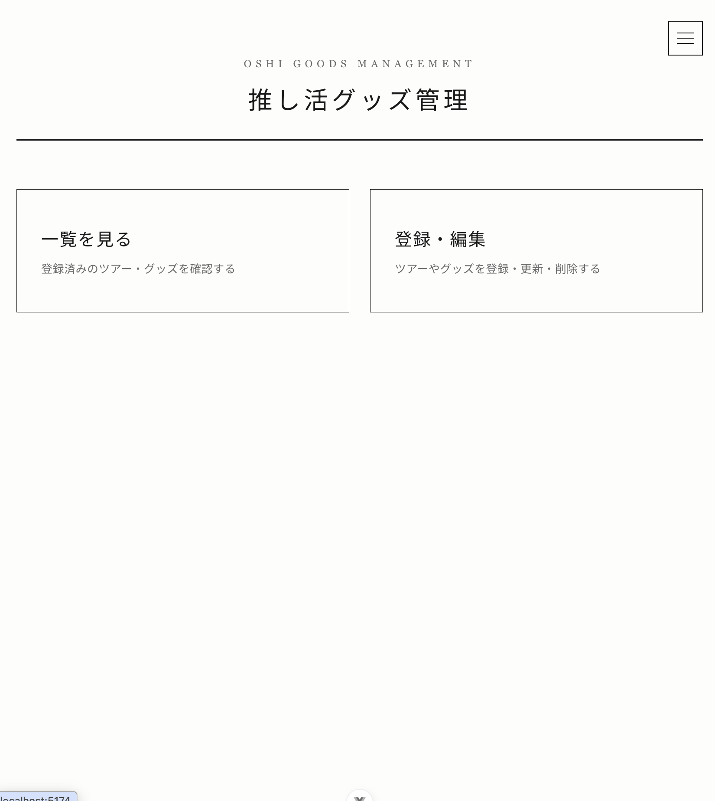
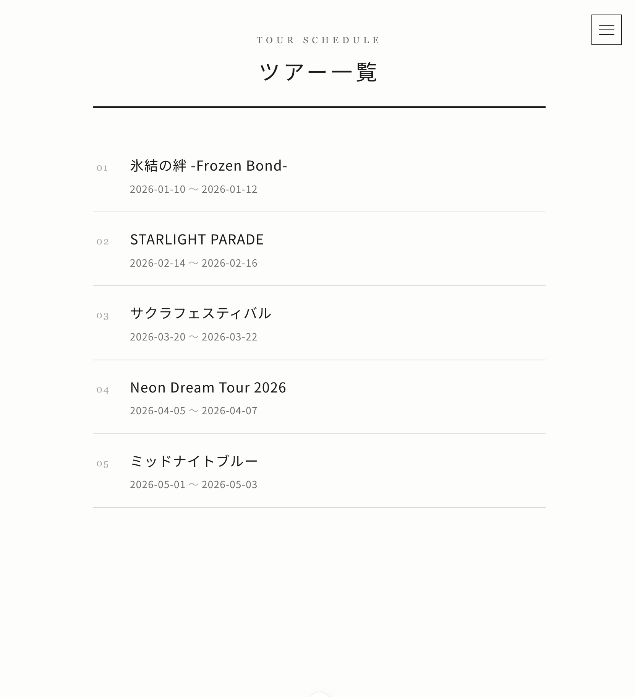
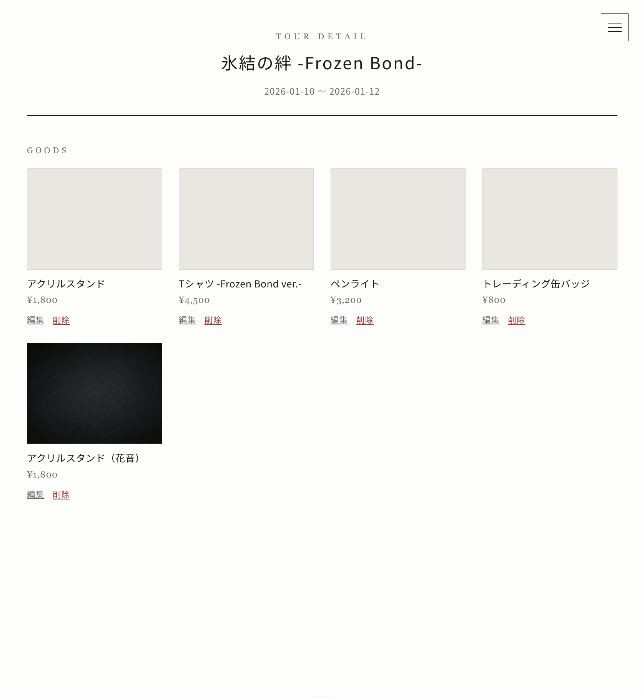
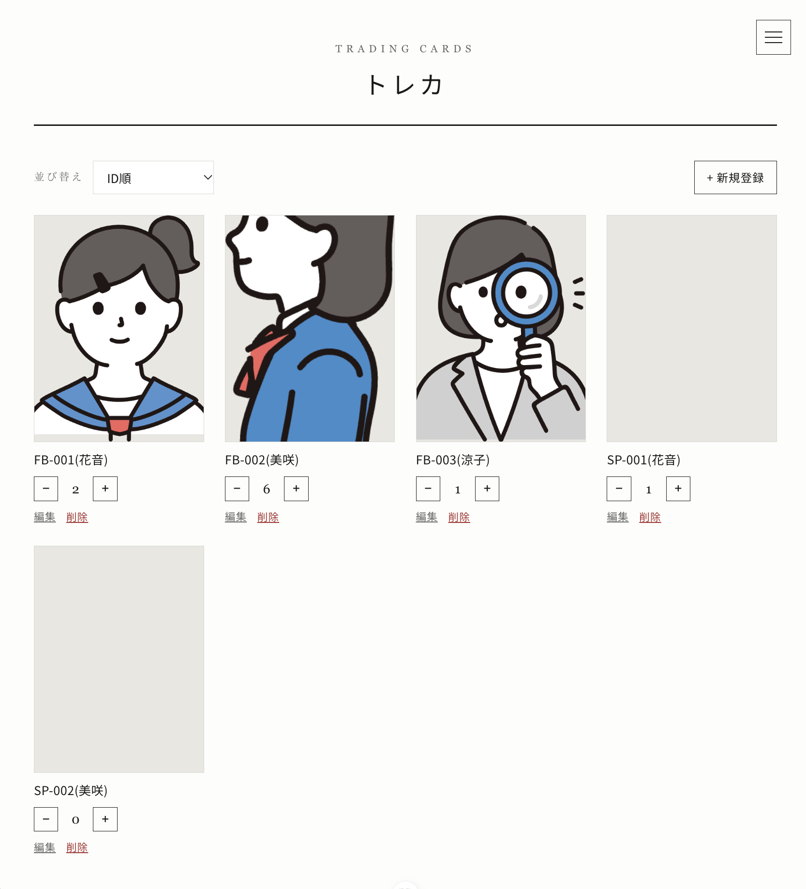

# goods-management（グッズ管理アプリ）

アーティストのツアーごとに、購入したグッズやトレーディングカードを記録・管理するWebアプリケーションです。
バックエンドを Laravel（REST API）、フロントエンドを Vue 3（SPA）で構成しています。

---

## 画面

| ホーム | ツアー一覧 |
| --- | --- |
|  |  |

| ツアー詳細（グッズ一覧） | トレカ一覧 |
| --- | --- |
|  |  |

ツアー詳細ではそのツアーに紐づくグッズを、トレカ一覧では所持枚数を `−` / `+` ボタンで増減できます。

---

## 開発背景・目的

ライブツアーやイベントで発売されるグッズやトレーディングカードは種類が多く、「何を買ったか」「どのカードを何枚持っているか」を記憶だけで管理するのは難しい。
本アプリは、購入状況と所持状況を整理し、自分のコレクションを一目で把握できるようにすることを目的としています。

あわせて、Web開発の学習として **要件定義 → 基本設計 → DB設計 → API設計 → 実装 → テスト** という工程を一通り自分で経験することも目的のひとつです。

学習対象として特に意識した点:

- **バックエンド** — MVCアーキテクチャ、Eloquent ORM、REST APIの設計、`FormRequest` によるバリデーションの分離
- **フロントエンド** — Vue 3のコンポーネント設計、リアクティビティ、axiosによるAPI通信
- **その他** — PostgreSQLのテーブル設計とリレーション、Dockerによる環境構築、Gitのブランチ運用とプルリクエスト

なお、実装の補助とコードの理解に Claude Code を活用しています。生成されたコードは内容を確認・理解したうえで採用し、設計上の判断は自分で行う方針で進めました。

---

## 設計ドキュメント

| 文書 | 内容 |
| --- | --- |
| [要件定義書](docs/requirements.md) | 開発背景、機能要件（F001〜F025）、画面要件、データ要件、API要件、非機能要件、開発工程 |

### 実装状況

要件定義書のうち、現時点で実装済みなのは **ツアー・グッズ・トレーディングカードの各CRUD** と **画像アップロード** です。
以下は要件に含まれていますが未実装です。

- イベント管理（F006〜F009）
- グッズ検索・カードID検索（F012 / F020）
- コンプリート率表示（F022）
- 購入金額集計（F016）

---

## 主な機能

### ツアー管理
- ツアーの一覧表示・詳細表示
- ツアー詳細画面から、そのツアーに紐づくグッズを確認

### グッズ管理
- 登録・編集・削除（論理削除）
- 画像アップロード（1枚、5MBまで）
- 購入状況の管理（`unpurchased` 未購入 / `purchased` 購入済み）
- カテゴリ・価格・購入日・メモの記録
- グッズ登録時に、新しいツアーを同時に新規作成できる

### トレーディングカード管理
- 登録・編集・削除（論理削除）
- 画像アップロード（1枚、5MBまで）
- 所持状況の管理（`not_owned` 未所持 / `owned` 所持）
- 所持枚数（`owned_count`）の記録

### UI
- ハンバーガーメニューによる画面遷移（ホーム / 一覧 / 登録画面 / トレカ画面）

---

## 技術スタック

| 区分 | 使用技術 |
| --- | --- |
| バックエンド | PHP 8.3+ / Laravel 13 / Laravel Sanctum |
| フロントエンド | Vue 3 / Vue Router 5 / Pinia / axios |
| ビルドツール | Vite 8 |
| データベース | PostgreSQL 18 |
| 開発環境 | Laravel Sail（Docker） |
| テスト | PHPUnit 12 |
| コード整形 | Laravel Pint / ESLint / oxlint / Prettier |
| AI開発支援 | Claude Code（実装補助・コード理解） |

---

## ディレクトリ構成

```
goods-management/
├── app/
│   ├── Http/
│   │   ├── Controllers/     # TourController, GoodsController, TradingCardController
│   │   └── Requests/        # バリデーション定義（FormRequest）
│   └── Models/              # Tour, Goods, TradingCard, User
├── database/
│   ├── migrations/          # テーブル定義
│   └── seeders/             # 初期データ（TourSeeder, GoodsSeeder, TradingCardSeeder）
├── routes/
│   └── api.php              # APIルート定義
├── tests/
│   └── Feature/             # 機能テスト（TradingCardTest ほか）
├── frontend/                # Vue 3 のSPA（独立したnpmプロジェクト）
│   └── src/
│       ├── views/           # 各画面のコンポーネント
│       ├── components/      # AppNav など共通パーツ
│       ├── router/          # 画面遷移の定義
│       └── services/api.js  # axios の共通設定
└── compose.yaml             # Docker（Sail）構成
```

---

## データベース構成

### tours（ツアー）

| カラム | 型 | 説明 |
| --- | --- | --- |
| `id` | bigint | 主キー |
| `name` | string | ツアー名（一意） |
| `start_date` | date | 開始日（任意） |
| `end_date` | date | 終了日（任意） |
| `description` | text | 説明（任意） |
| `deleted_at` | timestamp | 論理削除 |

### goods（グッズ）

| カラム | 型 | 説明 |
| --- | --- | --- |
| `id` | bigint | 主キー |
| `tour_id` | bigint | tours への外部キー（ツアー削除時に連動削除） |
| `name` | string | グッズ名 |
| `category` | string | カテゴリ |
| `price` | integer | 価格 |
| `purchase_status` | string | `unpurchased` / `purchased` |
| `purchased_at` | date | 購入日（任意） |
| `image_path` | string | 画像の保存パス（任意） |
| `description` | text | メモ（任意） |
| `deleted_at` | timestamp | 論理削除 |

### trading_cards（トレーディングカード）

| カラム | 型 | 説明 |
| --- | --- | --- |
| `id` | bigint | 主キー |
| `card_code` | string | カード識別コード（一意） |
| `member_name` | string | メンバー名 |
| `tour_id` | bigint | tours への外部キー（ツアー削除時に連動削除） |
| `possession_status` | string | `not_owned` / `owned` |
| `owned_count` | integer | 所持枚数（初期値 0） |
| `image_path` | string | 画像の保存パス（任意） |
| `description` | text | メモ（任意） |
| `deleted_at` | timestamp | 論理削除 |

---

## API エンドポイント

ベースURLは `http://localhost/api` です（Sail の起動ポートに合わせてください）。

| メソッド | パス | 説明 |
| --- | --- | --- |
| GET | `/api/tours` | ツアー一覧 |
| POST | `/api/tours` | ツアー登録 |
| GET | `/api/tours/{id}` | ツアー詳細 |
| PUT/PATCH | `/api/tours/{id}` | ツアー更新 |
| DELETE | `/api/tours/{id}` | ツアー削除 |
| GET | `/api/goods` | グッズ一覧（`?tour_id=` でツアー絞り込み可） |
| POST | `/api/goods` | グッズ登録（画像アップロード対応） |
| GET | `/api/goods/{id}` | グッズ詳細 |
| PUT/PATCH | `/api/goods/{id}` | グッズ更新 |
| DELETE | `/api/goods/{id}` | グッズ削除 |
| GET | `/api/trading-cards` | トレカ一覧 |
| POST | `/api/trading-cards` | トレカ登録（画像アップロード対応） |
| GET | `/api/trading-cards/{id}` | トレカ詳細 |
| PUT/PATCH | `/api/trading-cards/{id}` | トレカ更新 |
| DELETE | `/api/trading-cards/{id}` | トレカ削除 |

画像は `public` ディスクに保存されます（グッズ: `goods_images/`、トレカ: `trading_card_images/`）。

---

## 画面構成（フロントエンドのルート）

| パス | 画面 | 役割 |
| --- | --- | --- |
| `/` | HomeView | ホーム |
| `/tours` | TourListView | ツアー一覧 |
| `/tours/:id` | TourDetailView | ツアー詳細（紐づくグッズを表示） |
| `/tours/manage` | GoodsFormView | グッズ新規登録 |
| `/goods/:id/edit` | GoodsFormView | グッズ編集 |
| `/trading-cards` | TradingCardListView | トレカ一覧 |
| `/trading-cards/manage` | TradingCardFormView | トレカ新規登録 |
| `/trading-cards/:id/edit` | TradingCardFormView | トレカ編集 |

---

## セットアップ手順

### 必要なもの
- Docker Desktop
- PHP 8.3 以上 と Composer（初回の `composer install` 用）
- Node.js 22.18 以上（または 24.12 以上）

### 1. リポジトリを取得して環境変数を用意する

```bash
git clone <このリポジトリのURL>
cd goods-management
cp .env.example .env
```

`.env` の DB 設定を PostgreSQL（Sail）向けに書き換えます。

```dotenv
DB_CONNECTION=pgsql
DB_HOST=pgsql
DB_PORT=5432
DB_DATABASE=laravel
DB_USERNAME=sail
DB_PASSWORD=password
```

### 2. バックエンドを起動する

```bash
composer install
./vendor/bin/sail up -d
./vendor/bin/sail artisan key:generate
./vendor/bin/sail artisan migrate --seed
./vendor/bin/sail artisan storage:link
```

API が `http://localhost/api` で利用できるようになります。

### 3. フロントエンドを起動する

```bash
cd frontend
npm install
npm run dev
```

表示された URL（通常は `http://localhost:5173`）をブラウザで開きます。

---

## よく使うコマンド

### バックエンド

```bash
./vendor/bin/sail up -d          # 起動
./vendor/bin/sail down           # 停止
./vendor/bin/sail artisan test   # テスト実行
./vendor/bin/sail artisan migrate:fresh --seed  # DBを作り直して初期データ投入
./vendor/bin/sail pint           # コード整形
```

### フロントエンド

```bash
npm run dev      # 開発サーバー起動
npm run build    # 本番用ビルド
npm run lint     # ESLint / oxlint で検査・自動修正
npm run format   # Prettier で整形
```

---

## 補足

- 認証は Laravel Sanctum を導入済みですが、現時点では各 API に認証を適用していません（`/api/user` のみ `auth:sanctum`）。
- グッズ・トレカ・ツアーはすべて論理削除（SoftDeletes）で、削除後もレコードは残ります。
